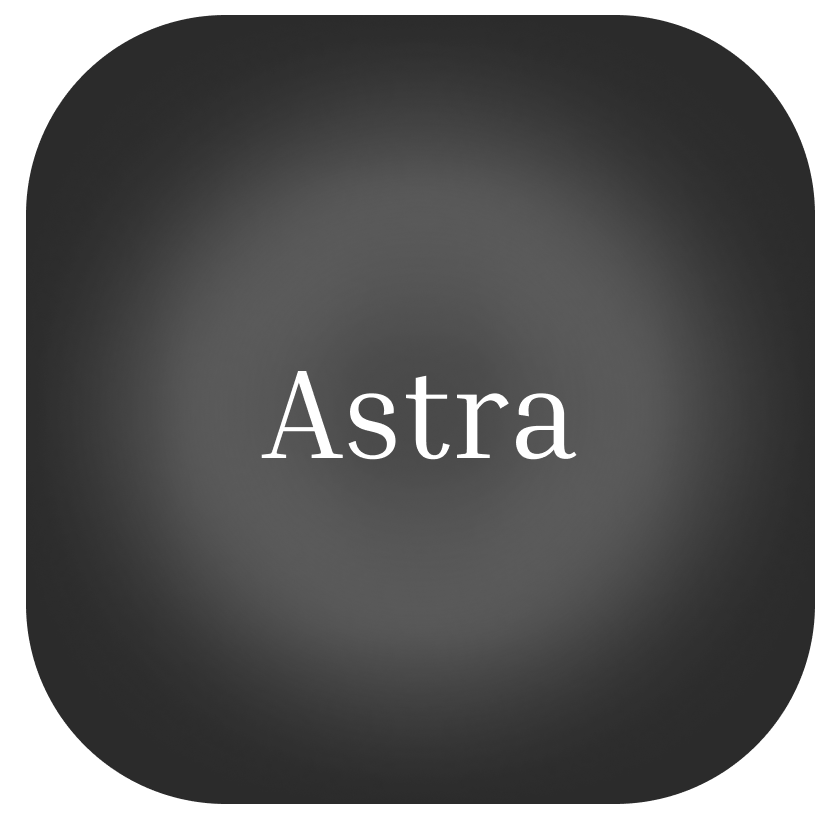

# Astra Launcher & Client

Create Minecraft Java Edition instances, install compatible Fabric mods, and customize your in-game HUD and world effects. Astra ships as a single Windows x64 executable. The optional in-game client runs on Fabric 26.3.

**[Download Astra for Windows](https://github.com/jojq21/Astra-Client/releases/latest/download/AstraLauncher.exe)** · [Release notes](https://github.com/jojq21/Astra-Client/releases/latest) · [Version history](CHANGELOG.md)

## In the launcher

| Feature | What you can do |
| --- | --- |
| Instances | Keep separate Vanilla and Fabric setups. Select an instance on the home screen to launch it. |
| Modrinth | Import Fabric modpacks or search for mods that match your instance. Manage installs and updates from the launcher. |
| Microsoft sign-in | Sign in with your own Minecraft Java Edition account and launch directly from Astra. Windows protects the saved session in your user profile. |

## In the game

- **HUD** — Arrange keystrokes, coordinates, speed and other widgets on a grid. Choose a compact layout or display the current Spotify desktop track.
- **World visuals** — Set a local day or night view, tint the fog, or add a player trail, jump circles and drifting Sakura petals.
- **Practice** — Spawn a local training player and choose its skin, health and knockback.

## First launch

1. Download and open **AstraLauncher.exe**. It extracts its bundled Qt runtime on first launch.
2. Open **Profile** and sign in. Under **Instances**, create an instance or import a Fabric modpack.
3. Select the instance and choose **Play**. To use the in-game client, enable **Astra Client** on a Fabric 26.3 instance and press **Right Shift** in game.

For later versions, open **Updates** in the launcher or visit [all releases](https://github.com/jojq21/Astra-Client/releases).
